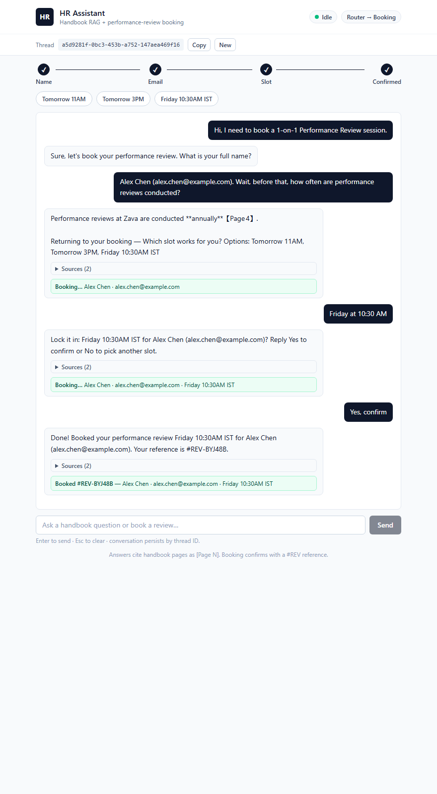
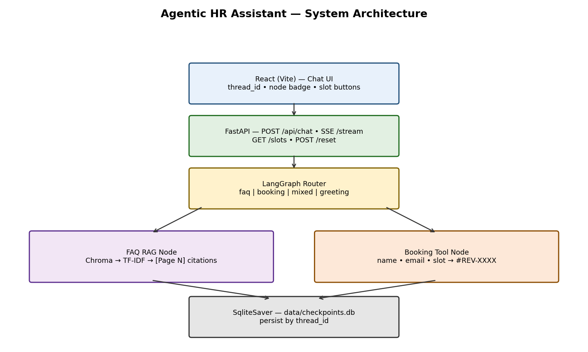
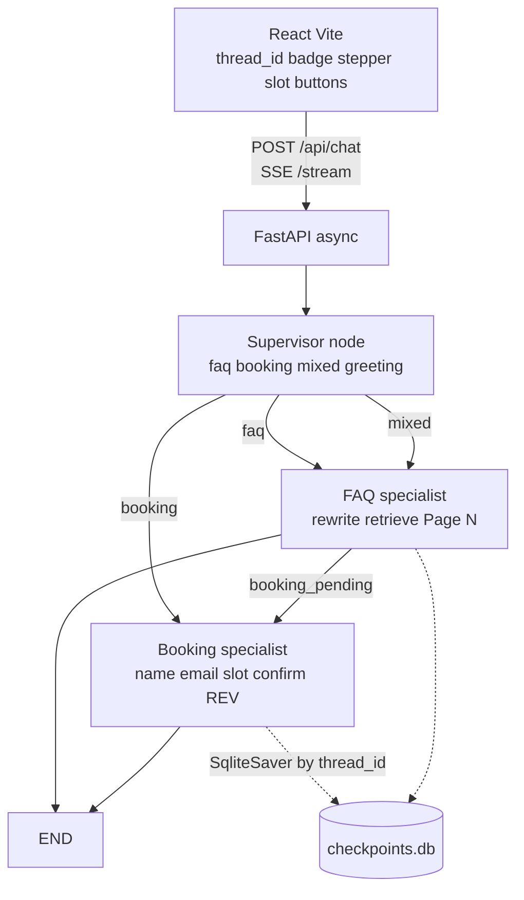
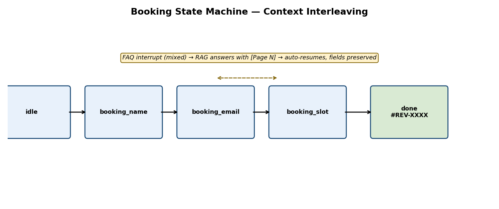

# Agentic HR Assistant — Full-Stack LangGraph RAG + Booking

     

Autonomous conversational assistant with **dual responsibility**: Domain Knowledge Retrieval (RAG over `employee_handbook.pdf` + `Northwind_Standard_Benefits_Details.pdf`) + Transactional Booking (multi-turn Performance Review scheduling). Preserves state across turns by `thread_id`, answers FAQ mid-booking and resumes without losing parameters.

> Runs **offline without API keys** (rule-based + TF-IDF fallback). Add Groq/Gemini keys for fluent LLM answers.

Repo: `https://github.com/Gourav-Shetty/agentic-hr-assistant`

## Demo — context interleaving (real output)



```
User:  Hi, I need to book a 1-on-1 Performance Review session.
Agent [booking]: Sure, let's book your performance review. What is your full name?

User:  Alex Chen (alex.chen@example.com). Wait, before that, how often are performance reviews conducted?
Agent [mixed, citations=[4]]: Performance reviews at Zava are conducted **annually** [Page 4].
        Returning to your booking — Which slot works for you? Options: Tomorrow 11AM, Tomorrow 3PM, Friday 10:30AM IST
        booking={name: Alex Chen, email: alex.chen@example.com}

User:  Friday at 10:30 AM
Agent [booking, stage=booking_confirm]: Lock it in: Friday 10:30AM IST for Alex Chen (alex.chen@example.com)? Reply Yes to confirm or No to pick another slot.

User:  Yes, confirm
Agent [booking, stage=done]: Done! Booked your performance review Friday 10:30AM IST for Alex Chen (alex.chen@example.com). Reference #REV-YWKY5B.
```

Full JSON: `docs/demo_transcript.json` (thread `demo-f97ff9`, regenerated live). Verification log: `docs/verify_log.txt` (18/18 PASS).

**Spec-conformance notes.** (1) The sample dialogue says reviews happen *"twice a year"*, but the actual handbook PDF (Page 4) says reviews are conducted **annually** — the agent faithfully reports the document (`annually [Page 4]`), which is the correct RAG behavior. (2) The sample books immediately on slot choice; this agent does the same for affirmed picks (`Let's go with Friday…`), and asks one explicit `Yes/No` confirm for bare slot clicks (human-in-the-loop). (3) Slots match the spec: Tomorrow 11AM / Tomorrow 3PM / Friday 10:30AM IST; refs are `#REV-XXXXXX` (6-char vs the sample's 4-char format).

## Architecture





Supervisor (`graph.py:supervisor_node`) routes every turn; specialists do the work — the classic supervisor/worker multi-agent pattern on a single StateGraph. Human-in-the-loop: bare slot picks are held at `stage=booking_confirm` (`Lock it in…? Yes/No`); affirmed slots (`Let's go with Friday…`) book immediately per the sample dialogue. Re-invokes on `done` return the existing booking, never a second ref.

State (`backend/app/graph/state.py`): `TypedDict` JSON-only — `messages, name, email, slot, stage, booking_pending, last_route, citations, booking_ref`. No Pydantic in state (SqliteSaver-safe). Pydantic lives only at API boundary (`schemas.py`).



Router (`router.py`): keywords first, LLM-free. Active booking defaults to `booking`; pure FAQ interrupt → `mixed`; idle slot/email clicks (`Tomorrow 11AM`, `ada@x.com`) → `booking`; `faq+booking verbs` → `booking`. RAG short-circuits greetings.

RAG (`rag/`): `pypdf` per-page parse → 800/150 splitter → `all-MiniLM-L6-v2` → Chroma persistent `./data/chroma` (page+source metadata). Fallbacks: `data/chunks.json` TF-IDF → keyword overlap. LLM query rewrite (2 variants, merged top-4) with acronym expansion fallback when offline. Always `[{text, page, source}]`. Golden-set eval: `python scripts/eval_rag.py` (8/8).
Knowledge base is dual-PDF: `employee_handbook.pdf` (source=`handbook`, policies + Page-4 performance reviews) + `Northwind_Standard_Benefits_Details.pdf` (source=`benefits`, PTO/leave/health). Context cites `[Page N]` or `[Page N (benefits)]`.

LLM (`graph/llm.py`): Groq `openai/gpt-oss-20b` (default) → Gemini `gemini-2.0-flash` → rule fallback. `.env` autoloaded; deprecated Llama IDs auto-map to `gpt-oss-20b` (Groq retired Llama free-tier Aug 2026). Guardrails (`guardrails.py`): injection blocklist enforced in `/api/chat` + `/stream`, email regex, slot allowlist, 2000-char cap.

## Quickstart

```bash
pip install -r backend/requirements.txt
cp .env.example .env   # Windows: copy .env.example .env — add GROQ_API_KEY / GEMINI_API_KEY, no quotes
python scripts/download_pdf.py          # handbook + benefits PDFs
python -m backend.app.rag.ingest --all  # 448 chunks (27 handbook + 421 benefits)
uvicorn backend.app.main:app --port 8000
cd frontend && npm install && npm run dev   # http://localhost:5173
```

Docker: `docker compose up --build` → backend `:8000`, frontend `:5173`.
Stop manual servers first (same ports). First build takes 10–20 min (CPU torch
embeddings); later starts take seconds. Keys optional: no `.env` → offline mode.
In compose, checkpoints live at `/tmp/checkpoints.db` (SQLite locking is flaky on
Windows bind mounts) — threads persist across turns while the container runs.

`.env` is gitignored and never pushed. Commit only `.env.example`.

## API

| Method | Path | Response |
|---|---|---|
| GET | `/health` | `{status: ok}` |
| POST | `/api/chat` `{message, thread_id}` | `{reply, route, stage, citations, booking{name,email,slot,reference}, thread_id}` |
| POST | `/api/chat/stream` | SSE `node{route,thread_id}` → `token{token}*` → `done{thread_id,route,stage,citations,booking,reply}` |
| GET | `/api/slots` | `{slots: [Tomorrow 11AM, Tomorrow 3PM, Friday 10:30AM IST]}` |
| POST | `/api/reset` `{thread_id}` | `{thread_id, status: reset}` |

`route` drives UI badge: `Router → FAQ RAG / Booking / Mixed`. `stage` (`idle|booking_name|booking_email|booking_slot|booking_confirm|done`) drives the progress stepper. `citations` renders `[Page N]`. `booking.reference` like `#REV-XXXXXX` (6-char CSPRNG) on `done`.

Frontend (`frontend/src`): `api.js` SSE parser, `App.jsx` thread copy/new + status dot, `Chat.jsx` slot buttons, `Stepper.jsx` Name→Email→Slot→Confirmed tracker, citation `<details>`, booking card, confirm row, suggestion chips, empty/typing/error states, aria-live, mobile-first. UI proof: `scripts/capture_ui.py` drives the real app in headless Chromium and saves `docs/screenshot_ui.png`.

## Verification

```bash
pytest tests/ -v                    # 9 passed, 2 skipped — router, booking validation, RAG pages
python scripts/verify.py            # OK — slots, Page-4 cite, booking, mixed resume, SSE, reset
python scripts/security_audit.py    # OK — 70+ adversarial checks (injection, fuzz, flood, isolation)
npm run build                       # vite build success (frontend/)
```

```
[PASS] RAG answer cites Page 4 (citations=[4])
[PASS] booking asks for name / email / slot
[PASS] booking asks to confirm (stage=booking_confirm)
[PASS] confirm-no releases slot
[PASS] booking completes with ref #REV-2R6WUP (6-char CSPRNG)
[PASS] affirmed slot books immediately
[PASS] FAQ interrupt answered mid-booking (route=mixed)
[PASS] booking resumes after interrupt (name kept)
[PASS] SSE stream emits node/token/done events
verify: OK
```

CI (`.github/workflows/ci.yml`) runs `pytest` + `verify.py` on every push/PR.

Manual: book via slot button on fresh thread, interrupt with PTO question mid-booking, restart backend — same `thread_id` history persists via `data/checkpoints.db`.

## Security

Adversarial audit: `python scripts/security_audit.py` — 70+ checks, all passing (log: `docs/security_audit_log.txt`).

Covered: 10 prompt-injection payloads (blocked pre-LLM), 3 live-LLM system-leak probes (Groq `gpt-oss-20b`, no leak), XSS/SQLi/traversal fuzz, evil `thread_id`s, cross-thread isolation, invalid-email/fake-slot rejection, 20-parallel flood, empty-message 422.

Hardening in place (`backend/app/api/chat.py`, `backend/app/tools/booking.py`):
- Rate limiting (100 chat POSTs/IP/min → 429), overlong `thread_id` (>128) minted fresh, history replay capped at 50 turns
- Booking refs are 6-char CSPRNG (`secrets`, 2B combos), 500 errors redact key-like strings and absolute paths
- Accepted risks (demo, no auth): thread IDs are unguessable UUIDs; `POST /api/reset` and CORS `*` are open by design for local eval.

## AI Engineering Log

Tools: Copilot, Cursor, Claude, ChatGPT.

1. **Checkpointer serialization** — AI put Pydantic models in `AgentState`; `SqliteSaver` checkpoint writes failed on resume. Diagnosed via `graph.get_state` pickle error. Fix: `TypedDict` primitives only, Pydantic at boundary.
2. **Blocking SSE** — AI called `graph.invoke` directly in async SSE generator, stalling streams. Diagnosed via concurrent stream timeout. Fix: `await asyncio.to_thread(graph.invoke…)` + `await asyncio.sleep(0)` yields in `api/chat.py`.
3. **Chroma Windows + offline** — AI assumed `chromadb` + OpenAI embeddings always available; builds fail offline. Diagnosed via `ImportError` on clean Windows. Fix: layered retriever Chroma → stdlib TF-IDF → keyword, local `all-MiniLM` only, `chunks.json` always written.
4. **Router amnesia + bare names** — AI returned `mixed` for `book + performance review`, dropping booking start; slot texts (`Friday 10:30AM`) had no booking keywords → `greeting`; bare `Gourav Shetty` replies extracted nothing → infinite name loop. Diagnosed via `verify.py` + TestClient transcripts. Fix: booking verbs win idle, slot/email clicks → `booking`, active FAQ-only → `mixed`; bare 1–3 capitalized words accepted as names (email-present or standalone, never from sentences); FAQ+booking replies merged with `Returning to your booking —` prefix preserving citations; greetings/gibberish mid-booking get contextual nudges (`holding Tomorrow 11AM`) instead of repeated prompts.
5. **Dead Groq model + unloaded `.env`** — AI defaulted to `llama-3.3-70b-versatile`; Groq retired it Aug 2026 → every call 404 `model_not_found` and the app silently ran rule-based fallback despite keys set (`llm.py` never called `load_dotenv`). Diagnosed by invoking the model directly and surfacing the hidden exception. Fix: default `openai/gpt-oss-20b`, deprecated-ID map, `load_dotenv()` in `llm.py`, `active_provider()` status helper.
6. **Fake Sources on refusals** — retriever force-returned `chunks[:k]` with zero signal, so out-of-scope answers (code requests, missing PTO text) carried `Sources (3)` for pages that don't support the answer. Diagnosed from UI transcript. Fix: return `[]` on no signal, out-of-scope short-circuit with `citations=[]`, PTO acronym expansion, strip citations when the LLM disavows its own context.
7. **Shadowed `_tid` + weak refs** — a duplicated `_tid` def meant the 128-char thread cap never ran (adversarial audit caught it: 10KB IDs stored); refs used `random` 4-char. Fix: removed shadow def, 6-char `secrets` refs, 100/min rate limiting with 429s, 50-turn history cap, key/path redaction in 500s — all covered by `scripts/security_audit.py` (70+ checks).
8. **Malformed SSE → silent double-invoke** — AI yielded raw dicts to `EventSourceResponse` (expects `ServerSentEvent`), producing an unparseable stream; the UI fell back to a second POST that re-invoked the graph on `done` state and rendered greeting text over a booked card. Diagnosed via headless-Chromium capture (`scripts/capture_ui.py`). Fix: hand-framed `StreamingResponse` SSE always, plus a `done`-state guard that returns the existing booking instead of minting a second ref.
9. **Stale citations + typo fragility** — booking turns echoed the previous RAG turn's `Sources` (state citations carried over unconditionally); `benegits` missed the router entirely; leading names (`Gourav but before that…`) were dropped. Diagnosed from a live UI transcript. Fix: citations attach only to mixed-resume turns, typo map + difflib backstop in the router (plus `interview` keyword), leading-capitalized-run name extraction.
10. **Done-state dead ends + false identity** — post-booking questions (`how will the interview go?`) hit the booked-summary guard because `interview` is a booking keyword; `what model are you?` let Groq claim to be OpenAI with junk `Sources (4)`. Diagnosed from a long live session. Fix: `done` + question → RAG (booking data preserved), `book another` restarts fresh, canned identity/capability replies with zero citations, system prompt forbids rival-model claims and markdown links.

## Structure

```
backend/app/{main.py,config.py,schemas.py,graph/{state,router,nodes,graph,llm,guardrails},rag/{ingest,retriever},tools/booking,api/{chat,slots}}
frontend/src/{App.jsx,api.js,components/Chat.jsx}
scripts/{download_pdf.py,verify.py,security_audit.py,make_diagrams.py,make_screenshot.py}
tests/test_{router,booking,rag}.py  docs/{architecture.png,state_diagram.png,screenshot_ui.png,demo_transcript.json,verify_log.txt,security_audit_log.txt}
```

## Submission

Public repo with clean history, `.env.example`, `Dockerfile` + `docker-compose.yml`, `SPEC.md`, `tasks/plan.md`, `docs/ADR-001-checkpointer.md`. Deadline 18 Oct 2026.
